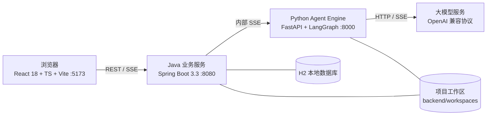

# AgentForge · 多 Agent 软件研发协作平台

一个可本地部署的多 Agent 协作平台：把「选模型 → 配 Agent → 组团队 → 协作完成软件项目」串成完整闭环。
平台由 **React 前端 + Spring Boot 业务服务 + Python Agent Engine** 三部分组成，支持流式对话、多 Agent 协作、AI 自动构建项目、真实执行测试、自动修复缺陷与 Git 交付。


---

## 目录

- [功能特性](#功能特性)
- [技术架构](#技术架构)
- [目录结构](#目录结构)
- [快速开始](#快速开始)
- [配置模型与 Agent](#配置模型与-agent)
- [AI 项目构建](#ai-项目构建)
- [API 一览](#api-一览)
- [数据与本地目录](#数据与本地目录)
- [常见问题](#常见问题)
- [安全与说明](#安全与说明)

---

## 功能特性

### 1. Agent 与模型

- 接入任意 **OpenAI 兼容协议** 的模型服务，自定义 `Base URL`、`API Key` 与模型名
- 支持拉取供应商可用模型列表、保存前一键测试连通性
- Agent 配置：角色、系统提示词、温度、工具开关、启用状态
- 单 Agent 流式对话与会话管理（SSE 实时输出）
- Token 费用统计与操作审计日志

### 2. 多 Agent 协作

- 创建团队并配置成员、协作模式（**顺序执行 / 群聊讨论**）
- 发起协作任务后实时查看：规划、每位 Agent 的产出、工具调用、推理过程
- 运行过程持久化，SSE 支持中途接入与历史事件回放
- 运行中支持 **暂停 / 继续 / 终止**，并保留完整执行记录

### 3. AI 软件项目构建

- 创建项目并选择技术栈：`Java + React`、`Node + React`、`Python + FastAPI`
- 完整流水线：
  **需求分析 → 架构设计 → 任务拆解（前端 / 后端 / 数据库）→ 代码生成（后端 Agent + 前端 Agent）→ 真实执行测试 → 缺陷修复（最多 3 轮）→ 项目交付文档**
- 文件管理：工作区文件树、代码在线预览、手工编辑、删除、ZIP 下载
- Git 集成：自动初始化仓库、提交代码、查看提交记录、创建与切换分支
- 构建过程 SSE 实时推送，支持暂停 / 继续 / 终止
- 交付物包含完整源码、`README.md`、需求 / 架构 / 任务 / 交付文档

### 4. 工程化

- 一条 `npm run dev` 同时拉起 Java、Python、前端三端
- 本地 H2 文件数据库，无需安装 MySQL / Redis 等外部服务
- SSE 事件总线统一处理协作运行与项目构建的实时事件
- 前后端分离，REST + SSE 契约清晰，便于二次开发

---

## 技术架构



| 模块 | 技术栈 | 端口 | 职责 |
| --- | --- | --- | --- |
| 前端 | React 18 · TypeScript · Vite | `5173` | 会话、团队协作、项目构建、Agent / 模型配置 |
| 业务服务 | Java 17 · Spring Boot 3.3 · Spring Data JPA · H2 | `8080` | 领域数据、运行编排、SSE 转发、工作区与 Git |
| Agent 引擎 | Python 3.12 · FastAPI · LangGraph · httpx | `8000` | Agent Loop、多 Agent 图编排、项目流水线、测试执行 |

---

## 目录结构

```text
Multi-agent-collaboration/
├─ src/                              # React 前端
│  ├─ components/                    # 会话、团队、项目构建、Agent / 模型配置
│  ├─ lib/                           # API 封装、SSE hooks
│  └─ data/presets.ts                # 前端预设数据
├─ backend/                          # Spring Boot 业务服务
│  ├─ src/main/java/com/agentforge/
│  │  ├─ web/                        # REST / SSE 接口
│  │  ├─ service/                    # 运行编排、项目构建、工作区、Git、费用、审计
│  │  ├─ domain/ repo/ dto/          # 实体、仓库、传输对象
│  │  ├─ engine/                     # Python Agent Engine 客户端
│  │  └─ seed/                       # 初始 Agent / 模型 / 团队 / 用户
│  ├─ data/                          # H2 数据库（运行时生成，已忽略）
│  ├─ workspaces/                    # AI 生成的项目工作区（已忽略）
│  ├─ mvnw / mvnw.cmd                # Maven Wrapper
│  └─ pom.xml
├─ agent-engine/                     # Python 多 Agent 引擎
│  ├─ app/
│  │  ├─ main.py                     # 内部 SSE 接口
│  │  ├─ runtime.py                  # 单 Agent 流式运行
│  │  ├─ team_graph.py               # 多 Agent 协作图
│  │  ├─ project_graph.py            # AI 项目构建流水线
│  │  ├─ fs_tools.py                 # 工作区文件读写（防路径穿越）
│  │  ├─ exec_tools.py               # 真实执行测试命令
│  │  ├─ providers.py                # OpenAI 兼容流式客户端
│  │  └─ control.py                  # 暂停 / 继续 / 终止控制
│  └─ requirements.txt
├─ vite.config.ts
├─ package.json
└─ README.md
```

---

## 快速开始

### 环境要求

| 依赖 | 版本 | 说明 |
| --- | --- | --- |
| JDK | 17+ | 运行 Spring Boot 服务 |
| Node.js | 20+ | 前端与 npm 脚本 |
| Python | 3.12 | 运行 Agent Engine |
| Maven | 无需单独安装 | 使用项目内置 `mvnw` |
| Git | 可选 | 项目构建的自动提交与分支管理 |

> 首次启动 Maven 会自动下载依赖，需要可访问 Maven Central。

### 安装与启动（Windows）

```powershell
# 1) 安装前端依赖
npm install

# 2) 创建 Python 虚拟环境并安装依赖（首次）
python -m venv agent-engine\.venv
agent-engine\.venv\Scripts\python.exe -m pip install -r agent-engine\requirements.txt

# 3) 一键启动三端（Java + Python + 前端）
npm run dev
```

### macOS / Linux

`dev:api` 使用 Windows 的 `mvnw.cmd`，在 macOS / Linux 上请分别启动三端：

```bash
# 后端
cd backend && ./mvnw spring-boot:run

# Agent 引擎
agent-engine/.venv/bin/python -m uvicorn app.main:app --host 127.0.0.1 --port 8000 --app-dir agent-engine

# 前端
npm run dev:web
```

### 访问地址

| 服务 | 地址 |
| --- | --- |
| 前端控制台 | http://localhost:5173 |
| Java API | http://localhost:8080/api |
| Agent Engine 健康检查 | http://localhost:8000/health |
| H2 控制台 | http://localhost:8080/h2-console |

---

## 配置模型与 Agent

1. 打开左侧「**模型中心**」，编辑或新建模型。
2. 填写：
   - `Base URL`：OpenAI 兼容地址，例如 `https://api.openai.com/v1`
   - `API Key`：供应商标注的密钥
   - `模型名`：例如 `gpt-4o`、`deepseek-chat`
3. 保存后点击「**测试连接**」，确认真实可用。
4. 打开「**Agent 配置**」，为每个 Agent 绑定模型，并按需调整系统提示词、温度与工具。
5. 至少准备 **一个可用模型**（已配置 Base URL 与 API Key），否则协作运行与项目构建会给出明确提示。

> 模型密钥保存在本地 H2 数据库中，不会上传到任何第三方。

---

## AI 项目构建

### 使用步骤

1. 左侧进入「**项目构建**」→「新建项目」，填写名称、技术栈与需求。
2. 在「需求与构建」中补充需求描述，点击「**启动 AI 构建**」。
3. 页面实时展示流水线阶段、Agent 产出、任务拆解、文件树、测试输出与 Git 记录。
4. 构建完成后：
   - 点击「**下载 ZIP**」获取完整项目；
   - 或直接打开本地工作区 `backend/workspaces/<项目ID>/`。

### 技术栈与测试方式

| 技术栈 | 生成内容 | 自动测试命令 |
| --- | --- | --- |
| `java-react` | Spring Boot 3 + React/Vite + H2 | `javac` 编译核心类与 `SmokeTest`，再 `java -cp .build-test SmokeTest` |
| `node-react` | Express + React/Vite | `node --test`（自动发现 `*.test.mjs`） |
| `python-fastapi` | FastAPI + React/Vite + SQLite | `python -m unittest discover -s tests -t . -v` |

测试命令由 Python 引擎在项目工作区中 **真实执行**，失败输出会回传给 Agent 进行修复，最多 3 轮修复后再次测试。

### 产物位置

```text
backend/workspaces/<项目ID>/
├─ backend/          # 后端代码
├─ frontend/         # 前端代码
├─ docs/             # 需求、架构、任务、交付文档
├─ tests/            # 自动化测试
├─ database/         # 建表脚本
└─ README.md
```

构建成功后会执行 `git init` 并自动提交一次；也可以在工作区中继续使用 Git 管理代码。

---

## API 一览

| 方法 | 路径 | 说明 |
| --- | --- | --- |
| GET | `/api/bootstrap` | 前端初始化数据 |
| GET / POST | `/api/agents` | Agent 列表 / 创建 |
| GET / POST | `/api/models` | 模型列表 / 创建 |
| POST | `/api/models/available` | 拉取供应商可用模型 |
| POST | `/api/models/{id}/test` | 测试模型连通性 |
| POST | `/api/chat/stream` | 单 Agent 流式对话（SSE） |
| GET | `/api/conversations` | 会话列表 / 详情 |
| GET / POST | `/api/teams` | 团队列表 / 创建 |
| POST | `/api/runs` | 发起多 Agent 协作运行 |
| GET | `/api/runs/{id}/stream` | 协作运行实时事件（SSE） |
| POST | `/api/runs/{id}/pause\|resume\|cancel` | 暂停 / 继续 / 终止 |
| GET / POST | `/api/projects` | 项目列表 / 创建 |
| POST | `/api/projects/{id}/build` | 启动 AI 项目构建 |
| GET | `/api/project-builds/{id}/stream` | 构建过程实时事件（SSE） |
| PUT / DELETE | `/api/projects/{id}/file` | 编辑 / 删除工作区文件 |
| GET | `/api/projects/{id}/files` | 工作区文件树 |
| GET | `/api/projects/{id}/download` | 下载项目 ZIP |
| GET / POST | `/api/projects/{id}/git/**` | Git 提交记录、提交、分支管理 |
| GET | `/api/costs/summary` | Token 费用统计 |
| GET | `/api/audits` | 审计日志 |

---

## 数据与本地目录

| 位置 | 内容 | 是否提交 Git |
| --- | --- | --- |
| `backend/data/` | H2 数据库（含模型密钥、Agent、运行记录） | 否 |
| `backend/workspaces/` | AI 生成的项目代码 | 否 |
| `agent-engine/.venv/` | Python 虚拟环境 | 否 |
| `node_modules/`、`dist/` | 前端依赖与构建产物 | 否 |

`.gitignore` 已排除数据库、工作区、依赖与构建产物，避免泄露 API Key 或上传大文件。

---

## 常见问题

**Q：启动后提示「Agent 引擎未启动」？**
确认 Python 引擎运行在 `http://127.0.0.1:8000`，可访问 `/health` 检查；首次需安装 `agent-engine/requirements.txt`。

**Q：协作或项目构建提示没有可用模型？**
在「模型中心」至少配置一个模型的 Base URL 与 API Key，并点击「测试连接」通过。

**Q：模型调用返回 401 / 404？**
检查 API Key 是否有效、`Base URL` 是否以 `/v1` 结尾、模型名是否与供应商一致。

**Q：8080 / 8000 / 5173 端口被占用？**
释放对应端口后重新执行 `npm run dev`；或分别启动三端并调整端口配置。

**Q：项目构建没有自动提交 Git？**
确认本机已安装 Git 并加入 `PATH`。即使不可用，代码与文档仍会正常生成到工作区。

**Q：首次启动很慢？**
Maven 需要首次下载 Spring Boot 依赖；后续启动会明显加快。

---

## 安全与说明

- 本项目用于学习与多 Agent 协作实践，AI 生成的代码请自行审查后再用于生产环境。
- 模型密钥仅保存在本地数据库，请勿将 `backend/data/` 提交到公开仓库。
- 建议为模型 Key 设置额度限制，并定期轮换。
